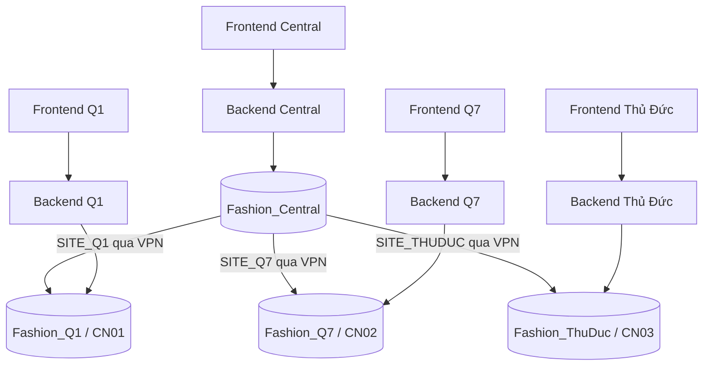

# Kiến trúc dự án

> Cập nhật: **2026-10-29**, đối chiếu commit `e2b0e3f`.
> Trạng thái & kế hoạch chi tiết: [`docs/PROJECT_STATUS.md`](PROJECT_STATUS.md).

Thiết kế bám theo README: bốn máy, SQL Server, Radmin VPN và Linked Server.

**Hiện trạng:** backend Spring Boot và frontend React đã chạy được với database cục bộ;
4 file schema đã có (Central + 3 site). **Chưa cài đặt**: replication, linked server,
trigger/queue đồng bộ, stored procedure phân tán. Các mục dưới đây mô tả kiến trúc **mục tiêu**,
phần nào đã có code sẽ ghi rõ.

## Phân chia hệ thống

Central truy vấn các site để tổng hợp báo cáo. Mỗi site có Linked Server `CENTRAL`; Central có
`SITE_Q1`, `SITE_Q7`, `SITE_THUDUC` (đặt tên theo **đích**, để stored procedure viết một lần
chạy được ở mọi nơi). Các mũi tên biểu diễn truy cập dữ liệu; replication cấu hình riêng.

## Phân bố dữ liệu

| Bảng | Vị trí và quy tắc | Trạng thái |
| --- | --- | --- |
| `SanPham` | Central quản lý danh mục gốc, nhân bản xuống site | Schema có; chưa replication |
| `ChiNhanh` | Danh mục dùng chung, thống nhất `CN01` / `CN02` / `CN03` | Schema có; FE đang lệch mã (xem dưới) |
| `KhachHang` | Dùng chung; đồng bộ hai chiều qua Central khi cho phép tạo tại site | Schema có; chưa đồng bộ |
| `NhanVien` | Riêng từng site; Central đọc để báo cáo | Schema có |
| `TonKho` | Phân mảnh ngang theo `MaChiNhanh`, chỉ ghi tại site sở hữu | Schema + API có; chưa phân tán |
| `HoaDon` | Phân mảnh ngang theo `MaChiNhanh`, chỉ ghi tại site sở hữu | Schema + API có; chưa phân tán |
| `ChiTietHoaDon` | Phân mảnh dẫn xuất theo `HoaDon`; cùng database với hóa đơn cha | Schema + API có |
| `TaiKhoan` | Đề xuất chỉ Central quản lý | Schema có ở cả 4; chưa chốt |

Central đọc dữ liệu giao dịch từ các site bằng Linked Server; không cần sao chép toàn bộ tồn kho
và hóa đơn về Central. Khóa hóa đơn và khách hàng cần duy nhất toàn hệ thống — **chưa chốt**
chiến lược (xem Q2/Q3 trong `PROJECT_STATUS.md`).

## Giao dịch bán hàng

Đã cài đặt trong `backend/.../service/SalesService.java` (`POST /api/sales/checkout`):

1. Backend xác định chi nhánh từ token, kiểm tra khách hàng và sản phẩm cục bộ.
2. Mở transaction `SERIALIZABLE`, khóa dòng tồn (`findForUpdate`) để chống bán vượt số lượng.
3. Lấy giá từ database, tạo `HoaDon` + `ChiTietHoaDon`, trừ `TonKho`.
4. Commit khi toàn bộ thành công; rollback khi lỗi.
5. Trả kết quả cho frontend.

Việc bán hàng **không phụ thuộc Central** — site chỉ cần backend + SQL Server cục bộ.
Còn thiếu: idempotency (`requestId`) để gửi lại không tạo hóa đơn trùng.

## Đồng bộ khách hàng và dữ liệu riêng

Linked Server chỉ cung cấp kết nối truy vấn, không tự đồng bộ thay đổi.

Yêu cầu thiết kế: nhận thay đổi từ site về Central, chuyển tới các site còn lại, lưu được thay đổi
khi mất mạng, thử lại không tạo bản ghi trùng, có quy tắc giải quyết xung đột. Đề xuất:
transactional replication cho bảng **chung**, trigger + bảng `SyncQueue` ở Central cho bảng **riêng**
(chi tiết trong `docs/setup.md` mục 6.5). Không triển khai đồng thời hai cơ chế cho cùng luồng.

`database/Fashion_Central.sql` đã có `sp_DongBoSanPham` làm ví dụ, nhưng còn 2 lỗi phải sửa:
dùng tên 3 phần `Fashion_Q1.dbo.*` (đòi linked server tên `Fashion_Q1`, lệch quy ước `SITE_Q1`)
và chỉ đồng bộ cột `TenSanPham`.

## Trách nhiệm từng file

| Đường dẫn | Vai trò |
| --- | --- |
| `database/Fashion_Central.sql` | Tạo DB Central: 8 bảng + `distributed_user` + `sp_DongBoSanPham`. **Chưa có** linked server |
| `database/Fashion_Q1.sql` | Tạo DB + 8 bảng cho Q1, có `distributed_user` |
| `database/Fashion_Q7.sql` | Tạo DB + 8 bảng cho Q7 (thiếu `distributed_user`) |
| `database/Fashion_TD.sql` | Tạo DB + 8 bảng cho Thủ Đức (tên DB đang là `Fashion_TD`, cần đổi `Fashion_ThuDuc`) |
| `backend/` | Spring Boot REST API: 12 controller, 50 endpoint, 73 test. `application-local.properties` là cấu hình mẫu (phải bật profile `local`) |
| `frontend/` | React + Vite; 30 trang; 10/11 service gọi API thật qua `src/api/client.js`; `siteService` còn mock |
| `docs/setup.md` | Runbook triển khai 4 máy (Agent, distribution, publication, linked server, trigger) |
| `docs/PROJECT_STATUS.md` | Nguồn sự thật về tiến độ, backlog, quyết định |

**Chưa có:** `database/common.sql`, `database/seed.sql`, `database/replication/*.sql`,
script linked server.

## Tài liệu cần bổ sung khi triển khai

- ERD từ database thực tế, bao gồm kiểu dữ liệu, khóa và ràng buộc.
- Sơ đồ định vị (W/E/D/R/H/L), thiết kế phân mảnh và chứng minh 3 quy tắc.
- Cấu hình replication, quyền truy cập, quy tắc xử lý xung đột và mã định danh.
- Ảnh ping, kiểm tra port, Linked Server và truy vấn phân tán.
- Bằng chứng bán hàng, tồn kho trước/sau và hoạt động khi mất Central.
