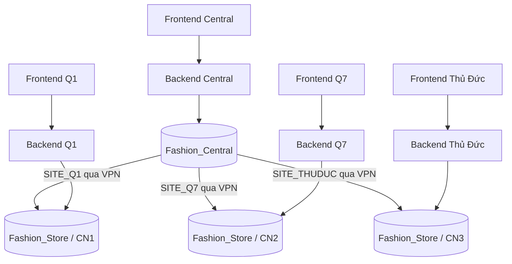

# Kiến trúc dự án

> Cập nhật: **2026-11-01**, đối chiếu commit và toàn bộ bộ script SQL phân tán đã hoàn thiện.
> Trạng thái & kế hoạch chi tiết: [`docs/PROJECT_STATUS.md`](PROJECT_STATUS.md).

Thiết kế bám theo yêu cầu đề tài và mẫu bài giảng giảng viên: bốn máy, SQL Server named instance `FASHION` (port `14333`), Radmin VPN, Linked Server và Merge Replication.

**Hiện trạng:** 
- Backend Spring Boot và frontend React đã hoàn thành chạy với database.
- Bộ 8 file SQL phân tán đã hoàn chỉnh 100%: DDL dùng chung, Central, Site (`Fashion_Store`), Linked Server 4 chiều, Merge Replication (Mô hình B1 chốt), Stored Procedures phân tán và Seed data 100 sản phẩm.
- Sẵn sàng triển khai trên môi trường thật 4 máy.

## Phân chia hệ thống

Central truy vấn các site để tổng hợp báo cáo. Mỗi site có Linked Server `CENTRAL`; Central có
`SITE_Q1`, `SITE_Q7`, `SITE_THUDUC` (đặt tên cố định theo **đích** trên cổng 14333, tuân thủ nguyên tắc trong suốt).

## Phân bố dữ liệu (Mô hình B1 - Merge Replication)

| Bảng | Vị trí và quy tắc | Trạng thái |
| --- | --- | --- |
| `SanPham` | Central quản lý danh mục gốc, nhân bản xuống 3 site qua `Pub_Common` | Schema + seed 100 SP; replication script có sẵn |
| `ChiNhanh` | Danh mục dùng chung, thống nhất mã `CN1` / `CN2` / `CN3` / `CN0` | Đã thống nhất toàn hệ thống (FE, BE, DB) |
| `KhachHang` | Dùng chung toàn cục; nhân bản 2 chiều qua `Pub_Common` (Merge Replication) kèm quy tắc Last-In-Wins | Bỏ UNIQUE SoDienThoai, có `LastModified`, tiền tố site `Q1-*`, `Q7-*`, `TD-*` |
| `NhanVien` | Phân mảnh ngang theo `MaChiNhanh`, nhân bản từ Central xuống site qua publication riêng | Đã cấu hình subset filter `MaChiNhanh` |
| `TonKho` | Phân mảnh ngang theo `MaChiNhanh`, site ghi cục bộ, Merge Agent đồng bộ 2 chiều lên Central | Đã seed 300 dòng tồn kho cho cả 3 chi nhánh |
| `HoaDon` | Phân mảnh ngang theo `MaChiNhanh`, site lập và đẩy đồng bộ lên Central | Tiền tố site `Q1-HD*`, `Q7-HD*`, `TD-HD*` |
| `ChiTietHoaDon` | Phân mảnh dẫn xuất theo `HoaDon` (kế thừa phân mảnh chi nhánh) | Cấu hình qua Join Filter (`sp_addmergejoinfilter`) |
| `TaiKhoan` | Phân mảnh dẫn xuất theo `NhanVien`, nhân bản xuống site (read-only) phục vụ đăng nhập local | Thuộc tính `NOT FOR REPLICATION` trên IDENTITY, Join Filter |

## Giao dịch bán hàng

Đã cài đặt trong `backend/.../service/SalesService.java` (`POST /api/sales/checkout`):

1. Backend xác định chi nhánh từ token, kiểm tra khách hàng và sản phẩm cục bộ.
2. Mở transaction `SERIALIZABLE`, khóa dòng tồn (`findForUpdate`) để chống bán vượt số lượng.
3. Lấy giá từ database, tạo `HoaDon` + `ChiTietHoaDon`, trừ `TonKho`.
4. Commit khi toàn bộ thành công; rollback khi lỗi.
5. Trả kết quả cho frontend.

Việc bán hàng **không phụ thuộc Central** — site hoàn toàn độc lập khi mất mạng nhờ database `Fashion_Store` cục bộ. Khi có mạng trở lại, Merge Agent tự động đẩy hóa đơn và cập nhật tồn kho lên Central.

## Đồng bộ dữ liệu

Đã chốt và cài đặt hoàn chỉnh **Mô hình B1 (Merge Replication)** trong `database/replication.sql`:
- **1 Publication dùng chung (`Pub_Common`)**: Chứa `SanPham`, `ChiNhanh`, `KhachHang` không lọc, push tới cả 3 site.
- **3 Publication theo chi nhánh (`Pub_Fashion_Store_Q1`, `Pub_Fashion_Store_Q7`, `Pub_Fashion_Store_ThuDuc`)**: Chứa `NhanVien`, `TonKho`, `HoaDon` (subset filter `MaChiNhanh`) kết hợp Join Filter cho `TaiKhoan` và `ChiTietHoaDon`.
- **Cơ chế dự phòng / thủ công**: `central-procs.sql` và `sites/site-procs.sql` cung cấp stored procedure đồng bộ thủ công qua Linked Server khi cần ép đồng bộ tức thì ngoài chu kỳ của Merge Agent.

## Trách nhiệm từng file trong `database/`

| Đường dẫn | Vai trò |
| --- | --- |
| `database/common.sql` | DDL dùng chung: 8 bảng, khóa ngoại, chỉ mục, template SP/trigger, `NOT FOR REPLICATION` trên `TaiKhoan`. |
| `database/Fashion_Central.sql` | Tạo DB Central (`Fashion_Central`), tạo `distributed_user`, insert danh mục 4 chi nhánh, trigger guard (cho phép `distributed_user`), aggregation views (`v_TonKho_ToanBo`, `v_HoaDon_ToanBo`, `v_DoanhThu_TheoChiNhanh`). |
| `database/sites/Fashion_Store.sql` | Tạo DB Site (`Fashion_Store` cho cả 3 site), insert chi nhánh sở hữu, trigger validate chi nhánh (`trg_HoaDon_ValidateBranch`), trigger guard chỉ đọc. |
| `database/linked-servers.sql` | Cấu hình Linked Server 4 chiều: Central trỏ `SITE_Q1`, `SITE_Q7`, `SITE_THUDUC`; Site trỏ `CENTRAL` (port 14333, login `distributed_user`). |
| `database/replication.sql` | Cấu hình Distributor, bật Merge publishing, tạo 4 Merge publications, add articles, join filters, push subscriptions và snapshots. |
| `database/central-procs.sql` | Stored procedure phân tán tại Central: đẩy sản phẩm, hợp nhất khách hàng (Last-In-Wins), đẩy tài khoản/nhân viên (có whitelist bảo mật), gom hóa đơn. |
| `database/sites/site-procs.sql` | Stored procedure phân tán tại Site: kéo khách hàng, kéo nhân viên/tài khoản chi nhánh, đẩy hóa đơn lên Central. |
| `database/seed.sql` | Dữ liệu mẫu chuẩn: 100 sản phẩm, 300 dòng tồn kho cho 3 chi nhánh, 15 khách hàng (tiền tố site), 10 nhân viên & tài khoản BCrypt, hóa đơn mẫu. |
