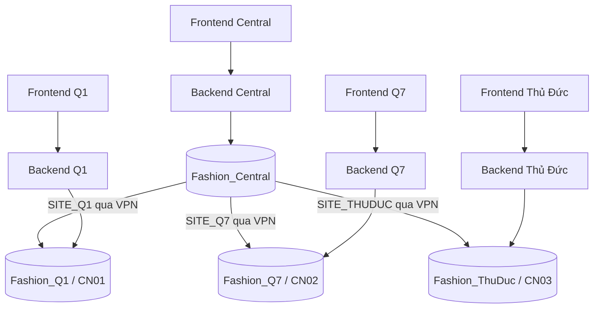

# Kiến trúc dự án

Thiết kế bám theo README: bốn máy, SQL Server, Radmin VPN và Linked Server. Đây là bộ khung triển khai; các file SQL hiện chỉ kiểm tra kết nối đã cấu hình và thông tin schema. Backend, frontend, stored procedure bán hàng và replication chưa được cài đặt.

## Phân chia hệ thống

Central truy vấn các site để tổng hợp báo cáo. Mỗi site có Linked Server `CENTRAL` theo mô hình kết nối trong README. Các mũi tên Linked Server biểu diễn truy cập dữ liệu; cơ chế replication được cấu hình riêng.

## Phân bố dữ liệu

| Bảng | Vị trí và quy tắc |
| --- | --- |
| SanPham | Đề xuất Central quản lý danh mục gốc; mỗi site có bản dùng cục bộ, cần chốt cách cập nhật |
| ChiNhanh | Danh mục dùng chung, thống nhất CN01 / CN02 / CN03 |
| KhachHang | Dùng chung; cần đồng bộ hai chiều qua Central khi cho phép tạo tại site |
| TonKho | Phân mảnh ngang theo MaChiNhanh, chỉ ghi tại site sở hữu |
| HoaDon | Phân mảnh ngang theo MaChiNhanh, chỉ ghi tại site sở hữu |
| ChiTietHoaDon | Phân mảnh dẫn xuất theo HoaDon; nằm cùng database với hóa đơn cha |

Central đọc dữ liệu giao dịch từ các site bằng Linked Server. Không cần sao chép toàn bộ tồn kho và hóa đơn về Central. Khóa hóa đơn và khách hàng cần duy nhất toàn hệ thống; chọn quy tắc phù hợp với kiểu dữ liệu hiện có sau khi kiểm tra schema.

## Giao dịch bán hàng

1. Backend site xác định chi nhánh, kiểm tra khách hàng và sản phẩm cục bộ.
2. Mở transaction cục bộ, kiểm tra và khóa/cập nhật tồn theo cách chống bán vượt số lượng khi có nhiều giao dịch đồng thời.
3. Lấy giá từ database, tạo hóa đơn, chi tiết và trừ tồn.
4. Commit khi toàn bộ thao tác thành công; rollback khi có lỗi.
5. Trả kết quả cho frontend. Khi gửi lại cùng yêu cầu, cơ chế chống trùng phải trả về giao dịch đã tạo hoặc từ chối tạo thêm.

Việc bán hàng không phụ thuộc truy vấn Central. Site vẫn cần backend và SQL Server cục bộ hoạt động. Nếu cần khách hàng chưa đồng bộ về site, phải có chính sách xử lý rõ ràng trước khi triển khai.

## Đồng bộ khách hàng

Linked Server chỉ cung cấp kết nối truy vấn, không tự đồng bộ thay đổi. Cần kiểm tra phiên bản/edition SQL Server và cấu hình replication hiện có trước khi chọn cơ chế.

Yêu cầu thiết kế: nhận thay đổi từ site về Central, chuyển tới các site còn lại, lưu được thay đổi khi mất mạng, thử lại không tạo bản ghi trùng và có quy tắc giải quyết cập nhật xung đột. Nếu dùng SQL Server replication, cấu hình publication/subscription và tác vụ đồng bộ riêng; nếu tự viết đồng bộ, cần nơi lưu thay đổi bền vững và trạng thái đã xử lý. Không triển khai đồng thời hai cơ chế cho cùng luồng dữ liệu.

## Trách nhiệm từng file

| Đường dẫn | Vai trò |
| --- | --- |
| database/central.sql | Kiểm tra Central, danh sách Linked Server và mẫu truy vấn tồn kho toàn hệ thống |
| database/q1.sql | Kiểm tra database Q1 và mẫu kiểm tra phân mảnh CN01 |
| database/q7.sql | Kiểm tra database Q7 và mẫu kiểm tra phân mảnh CN02 |
| database/thuduc.sql | Kiểm tra database Thủ Đức và mẫu kiểm tra phân mảnh CN03 |
| database/common.sql | Kiểm kê schema chung; nơi bổ sung stored procedure sau khi có schema thật |
| backend/ | API và xử lý nghiệp vụ |
| frontend/ | Giao diện sử dụng API |
| docs/ | Thiết kế, hướng dẫn triển khai và bằng chứng demo |

## Tài liệu cần bổ sung khi triển khai

- ERD từ database thực tế, bao gồm kiểu dữ liệu, khóa và ràng buộc.
- Cấu hình replication, quyền truy cập, quy tắc xử lý xung đột và mã định danh.
- Ảnh ping, kiểm tra port, Linked Server và truy vấn phân tán.
- Bằng chứng bán hàng, tồn kho trước/sau và hoạt động khi mất Central.
